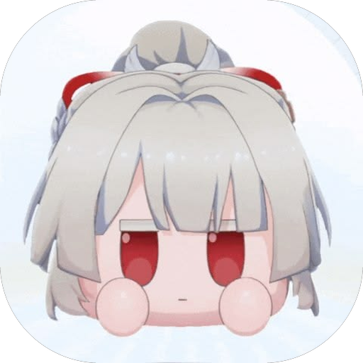

<p align="center"></p>

# YukiShell

A Catppuccin Mocha (mauve + pink) rice for **Hyprland** with its own desktop shell, built on **Quickshell**.

- **YukiShell**: menu bar, dock, Spotlight, Control Center, widgets, notifications and a Settings app
- **YukiLock**: the lock screen
- The Hyprland config (Lua), kitty, fish, fastfetch, btop, cava, GTK 3/4 and Qt/KDE themes to match

YukiShell is a fork of [MacShell](https://github.com/0-ss/MacShell) by Rickky and vSuol (MIT). It is completely separate from
upstream: it has its own name, config path, installer and Settings app, and it never phones home to MacShell.

Made by [Phong (@feixue56)](https://github.com/feixue56).

## Install

Needs Hyprland with the **Lua config** (written and tested on 0.56.2, CachyOS, NVIDIA) and Quickshell.

```sh
git clone https://github.com/feixue56/YukiShell.git ~/hypr-rice
cd ~/hypr-rice && ./install.sh
```

`install.sh` symlinks the files into `~/.config` (anything already there is moved to `*.pre-rice` once), adds one `require`
line to `~/.config/hypr/hyprland.lua`, and sets the GTK/Qt/btop themes. Re-run it any time; it is idempotent.

Packages the rice expects: `kitty fish fastfetch btop cava tty-clock fcitx5 fcitx5-bamboo adw-gtk-theme papirus-icon-theme
plasma-integration ddcutil brightnessctl python-numpy` and the Bibata cursor and JetBrainsMono Nerd Font. The shell itself uses `nmcli`, `playerctl`,
`powerprofilesctl`, `grim`, `imagemagick`, `wl-clipboard`, `cliphist` and `hyprsunset` for the matching features; whatever is missing just disables that feature.
`python-numpy` is only for generating the UI sound effects. **`tools/doctor`** (run by the installer too) lists exactly what is missing on your machine and what it would disable.

Before using it, check:

- `hypr/rice/monitor.lua`: resolution and refresh rate (it is pinned to 1920x1080@100 for my monitor)
- `fastfetch/config.jsonc`: `logo.source` points at a personal picture that is not in this repo; change it or remove the image

## Keybinds

`Super` is the main modifier.

| Keys | Action |
| --- | --- |
| `Super+Enter` | terminal (kitty) |
| `Super+Shift+Enter` | floating terminal |
| `Super+W` / `Super+E` | Chromium / Dolphin |
| `Super+Shift+W` / `Super+Shift+E` | floating Chromium / Dolphin (1280×800 / 1100×700, centred) |
| `Super+Q` | close window |
| `Super+F` | fullscreen |
| `Super+T` or `Super+Alt+Space` | toggle floating |
| `Super+Shift+Tab` | terminal opacity: solid → liquid glass → completely transparent |
| `Super+Alt+D` | dashboard (fastfetch, clock, cava) |
| `Super+1..0` | go to workspace 1-10 |
| `Super+Shift+1..0` or `Super+Alt+1..0` | move window to workspace |
| `Super+Scroll` | next / previous workspace |
| `Super+Arrows` (or `H K N`) | move focus |
| `Super+Ctrl+Arrows` | resize the window from the keyboard |
| `Super+Left/Right mouse` | drag / resize a window |
| `Super+S`, `Super+Shift+S` | scratchpad, send window to it |
| `Super+Shift+Arrows` | swap the window with its neighbour |
| `Super+Z` | System Settings |
| `Super+Space` / `Super+V` / `Super+.` | Spotlight / clipboard history / emoji |
| `Alt+Tab` | window switcher |
| `Print` / `Shift+Print` / `Ctrl+Print` | screenshot: region / screen / window |
| `Super+G` | Game Mode (the shell pauses its effects) |
| `Super+,` | notification centre |
| `Super+L` | lock screen |
| `Super+Shift+R` | restart the shell cleanly (`yuki-restart`) |
| `Super+Shift+C` | reload the Hyprland config |

There is deliberately no key that exits Hyprland. The full list is in `hypr/rice/binds.lua` and `shell.lua`; **System Settings → Keyboard → Keyboard
Shortcuts** shows the same list, translated and read live from the running Hyprland. A bind appears there as soon as you give it a
`description` (`hl.bind(keys, dispatcher, { description = "Open Terminal" })`; `binds.lua` has a small `bind()` helper for it), and
`tools/i18n-check.py` reminds you to translate it.

## What it does

- **Liquid Glass** menus, Dock, widgets and Settings, optionally with the *animated wallpaper playing inside the glass*. While windows
  cover the desktop that video is switched off completely, so it costs nothing when you cannot see it.
- Hover feedback everywhere: the menu bar and Dock buttons get a frosted-glass tile with a rim light that follows the pointer,
  workspaces that have windows keep a resting glass tile, and the Dock's last button is a gear that opens Settings.
- **Settings → Users & Groups → Picture** lets you crop your profile picture (drag, scroll to zoom) before it is saved.
- **Airplane Mode** follows the real radio switches (rfkill); on a PC with no radios it stays off and greyed out.
- File pickers ("Choose a picture", Open/Save dialogs) float, centred, instead of tiling.

## Multi-language typing

`hypr/rice/ime.lua` starts **fcitx5** with the session and exports the input-method variables; `chromium/chromium-flags.conf`
lets Chromium use it on Wayland. The fcitx5 profile (Vietnamese Bamboo, Pinyin) lives in `~/.config/fcitx5`.
**Ctrl+Space** switches the input method on and off (Telex: `chaof` → `chào`). Apps that were already running when fcitx5
was added need a restart.

## Interface language

**System Settings → General → Language** switches the whole shell (menu bar, Dock, Spotlight, Control Center, Settings, the
widgets and the lock screen) live, no restart: English, 简体中文, 繁體中文, 日本語, 한국어, Tiếng Việt and Русский, or
*Automatic* to follow `LANG`. Dates, day and month names follow the chosen language too. Anything without a translation
falls back to English.

The tables are `shell/YukiShell/lang/<code>.js` (keys are the English texts used in the QML) plus a small block per language in
`shell/YukiLock/I18n.js`. To add a language, copy `lang/vi.js`, translate the values, and register it in `dicts` and
`languages` in `shell/YukiShell/I18n.js`. Typing in Japanese, Korean or Traditional Chinese needs the matching fcitx5 input
method (`fcitx5-mozc`, `fcitx5-hangul`, `fcitx5-chewing`); the profile only ships Bamboo and Pinyin.

## Layout

| Path | What |
| --- | --- |
| `hypr/rice/` | Hyprland Lua modules: `theme monitor look input ime binds rules shell` |
| `hypr/bin/` | `dashboard`, `toggle-opacity` |
| `shell/YukiShell`, `shell/YukiLock` | the Quickshell shell and lock screen (`qs -c YukiShell`, `qs -c YukiLock`) |
| `shell/bin/` | `yuki-start` (keeps the shell running), `yuki-restart` (restarts it cleanly), `yuki-brightness` |
| `shell/scripts/` | helpers the shell calls: wallpaper (`yukishell-setwall.sh`, `-dynwall.sh`, `-wallpause.sh`), Game Mode, UI sound generator |
| `kitty fish fastfetch btop cava gtk-3.0 gtk-4.0 qt chromium` | app configs and themes |
| `tools/` | `doctor` (what is missing on this machine), `check` (lints the repo), `i18n-check.py` (missing translations), `make-logo.py`, `fix-font-loops.py` |

The palette lives in `hypr/rice/theme.lua`. Env overrides go in `~/.config/hypr-rice/env`; the shell log is
`~/.local/state/hypr-rice/YukiShell.log`. Open Settings with `qs -c YukiShell ipc call settings open`.

The shell keeps its settings in `~/.config/yukibar`, `yukidock`, `yukishell`, `yukilock` and `yukiwidgets`. They are its own
folders: YukiShell never reads or writes MacShell's, and never runs MacShell's installer or updater.

## Hacking on it

QML changes hot-reload as soon as you save; language tables (`lang/*.js`) are cached, so use `yuki-restart` (or `Super+Shift+R`)
after editing those. Run `tools/check` before committing: it syntax-checks the Lua, fish, shell, Python, JSON, JS and QML files and
reports every interface string that a language is missing. A quick CPU check: `top -p $(pgrep -f '^qs -c YukiShell')`.

## Credits and license

MIT, see [LICENSE](LICENSE). YukiShell and YukiLock are derived from [MacShell](https://github.com/0-ss/MacShell) by
Rickky (original author) and vSuol (contributor), whose copyright notice is kept in the license. Bundled third-party pieces
(the Open Runde fonts, GitHub gemoji data, icons) keep their own licenses.
